# Brass Lasers

Void-purple chrome. Brass-gold hardware. Hot-pink lasers cutting the fog.

A family of neon synthwave color themes, built for that stretch of night when the playlist goes Griz → Pretty Lights → Big G and the only responsible adult left in the room is your syntax highlighter. Funky EDM energy. Still readable. Still slap. **Every color is contrast-checked against WCAG on every commit.**

> Not affiliated with Griz, Pretty Lights, Big G, T3 Tools, or anyone's light show. Just vibes + hex codes.

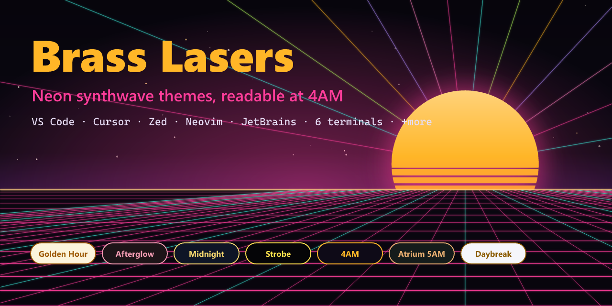

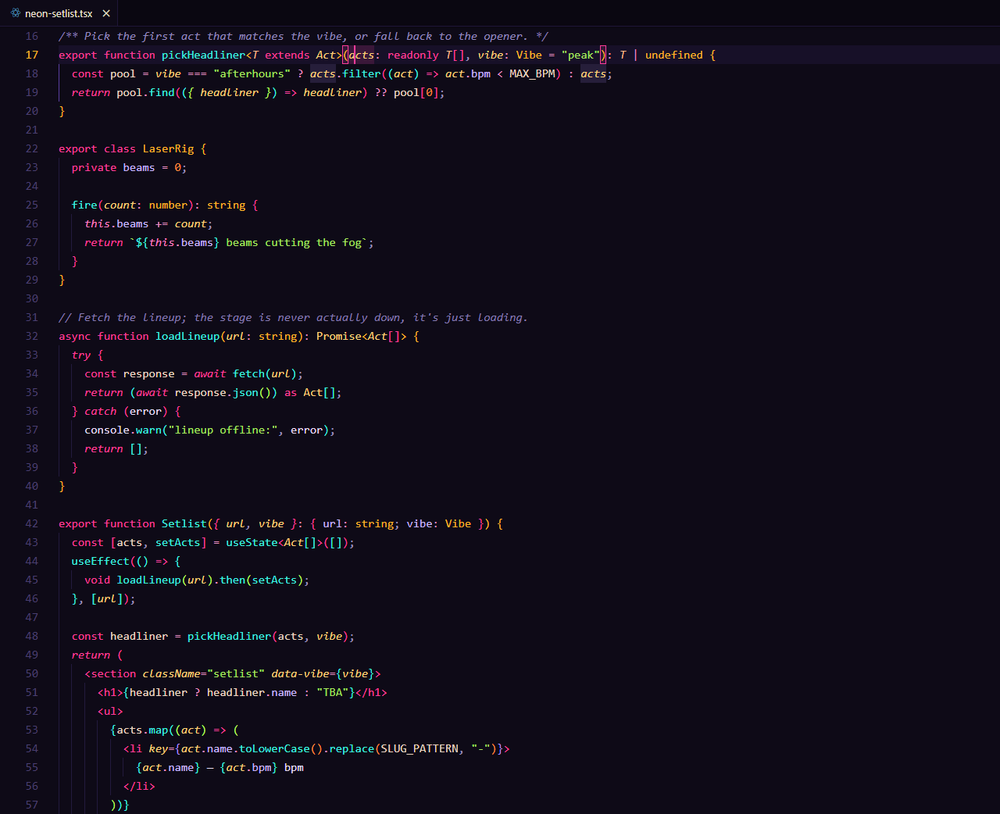

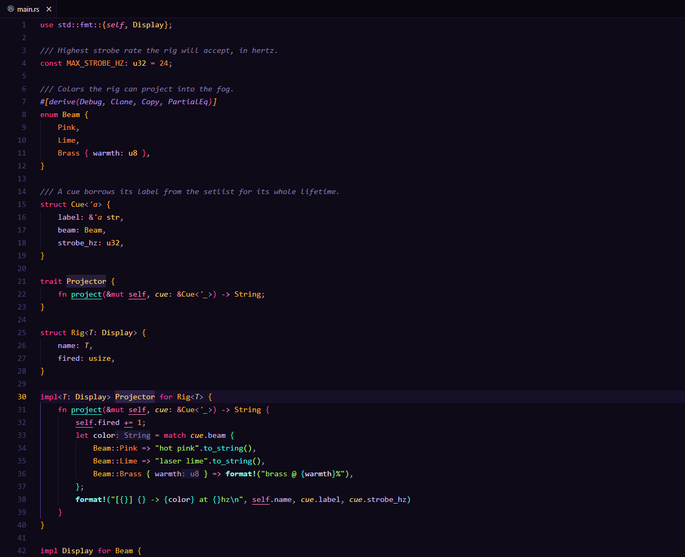

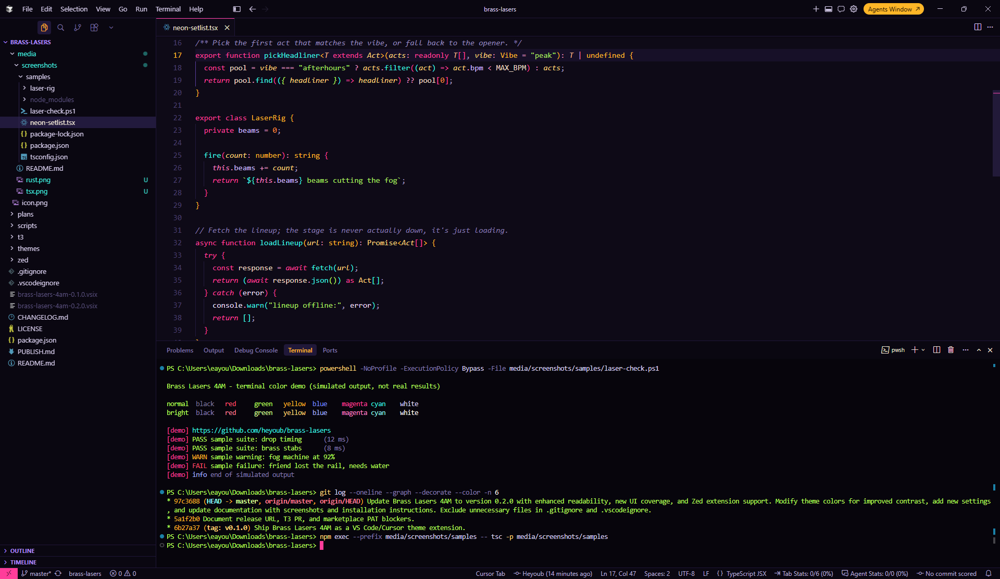

---

## The lineup: a day at the festival

Seven sets, one for every hour that matters. Each has its own room, its own light, its own reason to exist.

| Time | Set | Room | |
|---|---|---|---|
| 5PM | **Golden Hour** · light | The Lagoon Stage. Solarized-subtropical daylight: papaya-cream paper, lagoon ink, hibiscus, palm and mango. | 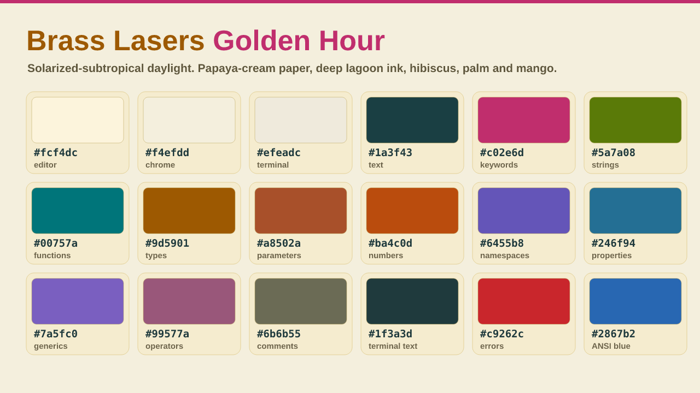 |
| 8PM | **Afterglow** | The Dusk Set. Wine-plum sky, coral clouds, mint grass, blue-hour light. | 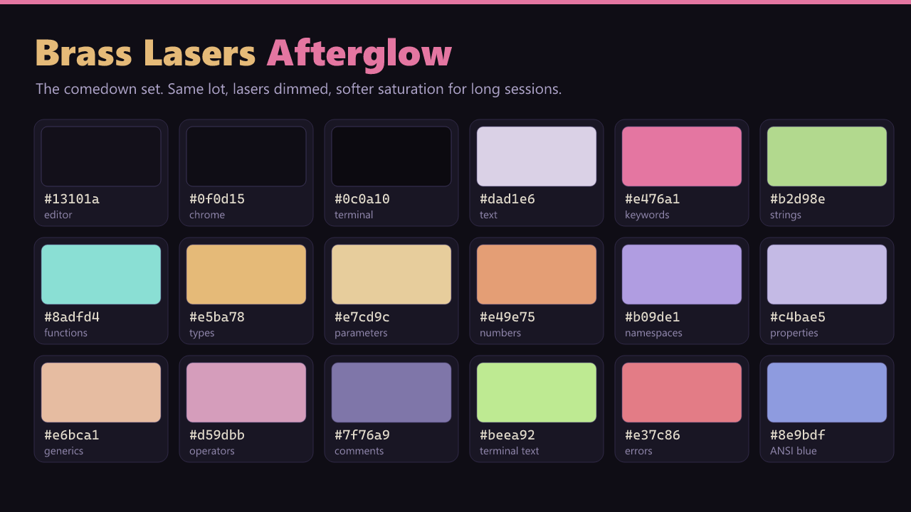 |
| 12AM | **Midnight** | The Night Market. Navy ink, moonlight text, sodium-orange streetlights. | 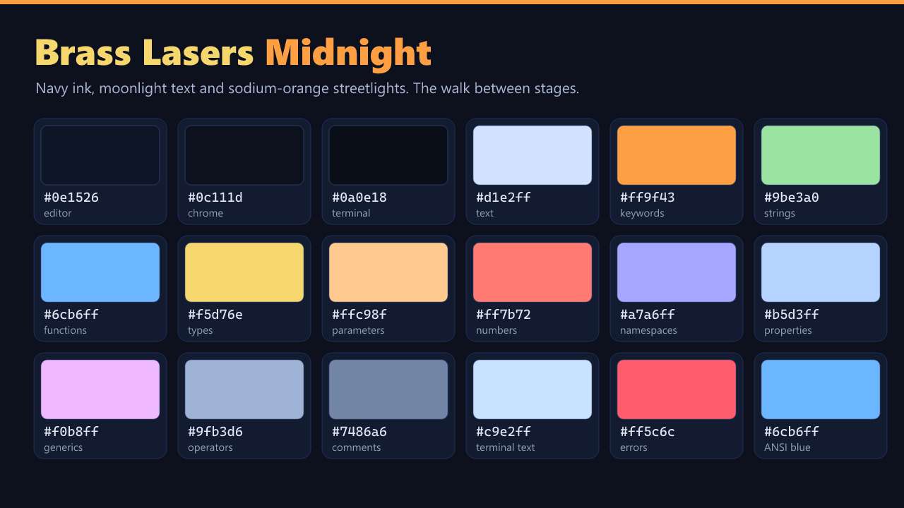 |
| 2AM | **Strobe** · high contrast | The Warehouse. Pure black, UV magenta, electric cyan, every syntax color at WCAG **AAA** (7:1). | 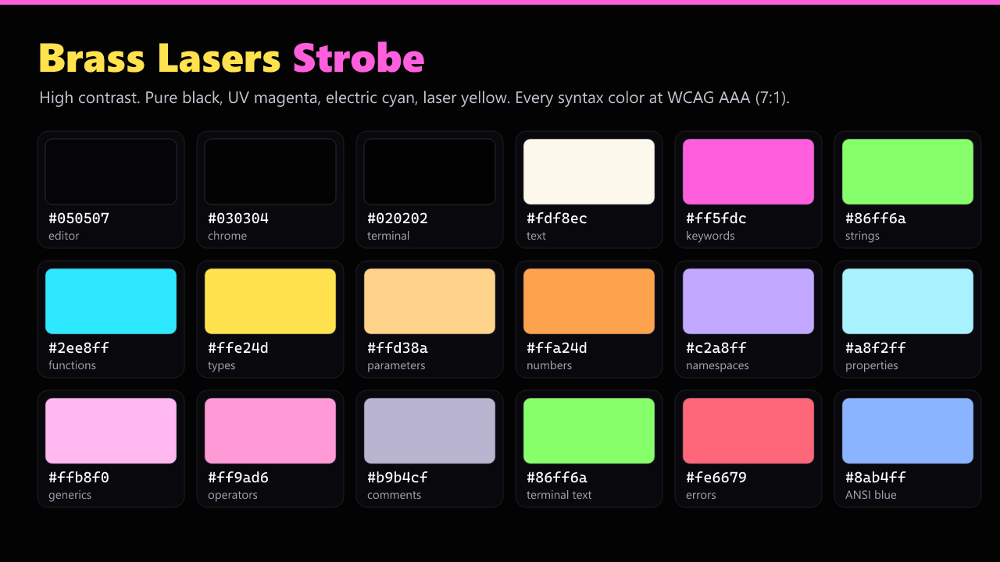 |
| 4AM | **4AM** · the original | The Main Stage. Void purple, brass, hot-pink lasers. | 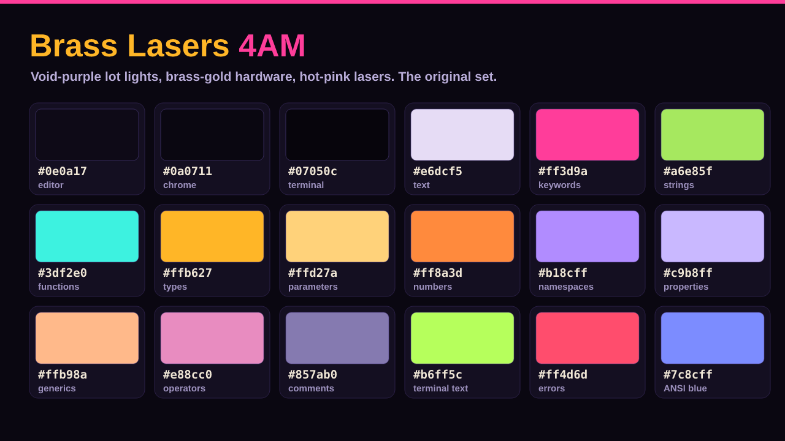 |
| 5AM | **Atrium 5AM** | The Greenhouse. A biophilic sci-fi workspace: forest-charcoal, lagoon holograms, moss, orchid displays, lantern light. Soft but legible. | 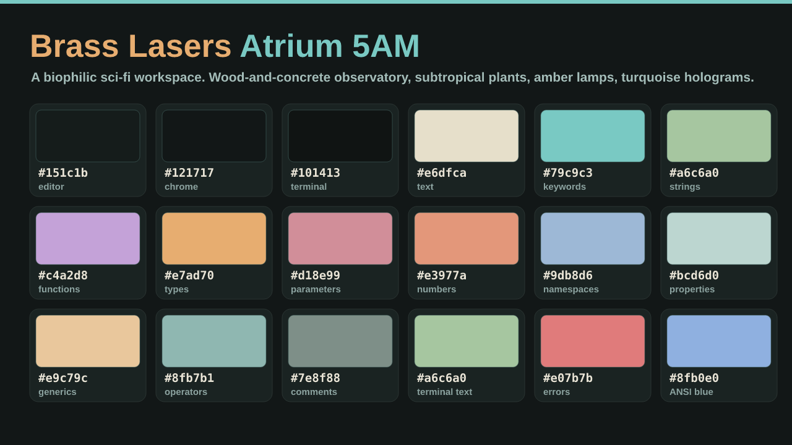 |
| 6AM | **Daybreak** · light | The Sunrise Walk. Porcelain mist, indigo ink, dawn-rose keywords, dew-green strings. | 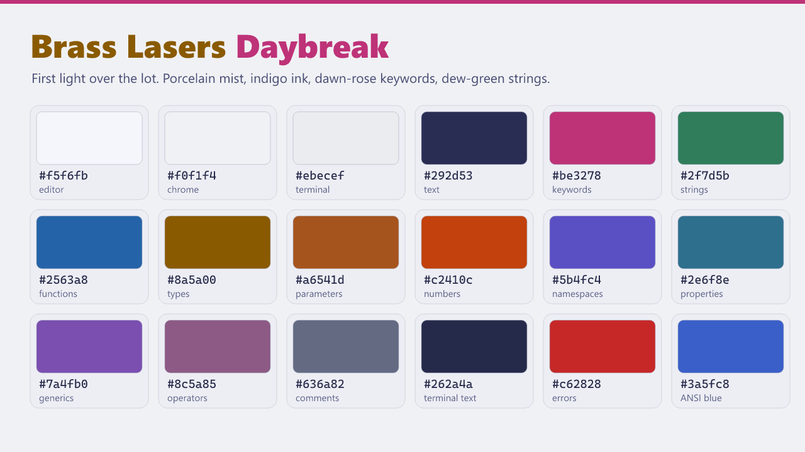 |

Every set also ships a **No Italics** flavor, for people who'd rather not see comments and keywords lean. That's 14 themes in the picker.

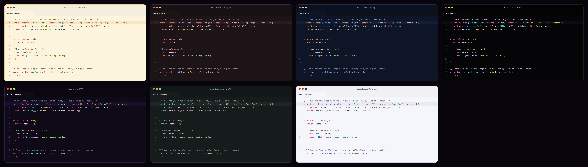

---

## Install

**VS Code:** Extensions → search **Brass Lasers 4AM** (publisher `heyoub`), or:

```bash
code --install-extension heyoub.brass-lasers-4am
```

**Cursor / VSCodium:** these pull from [Open VSX](https://open-vsx.org/extension/heyoub/brass-lasers-4am). Search **Brass Lasers 4AM** in Extensions.

**From a VSIX:** grab it from the [latest release](https://github.com/heyoub/brass-lasers/releases/latest) → Extensions → `…` → **Install from VSIX…**

Then `Ctrl+K Ctrl+T` (Mac: `Cmd+K Cmd+T`) and pick any **Brass Lasers** set. Let the void purple settle in. Hydrate. Maybe stretch.

### Follow the sun

Let the editor swap between a night set and a day set with your OS light/dark mode (any pair works; Atrium 5AM + Daybreak is lovely too):

```json
{
  "window.autoDetectColorScheme": true,
  "workbench.preferredDarkColorTheme": "Brass Lasers 4AM",
  "workbench.preferredLightColorTheme": "Brass Lasers Golden Hour"
}
```

### Recommended settings

The theme looks good with anything. These make it look its best:

```json
{
  "editor.fontFamily": "'Cascadia Code', 'JetBrains Mono', 'Fira Code', monospace",
  "editor.fontLigatures": true,
  "editor.fontSize": 15,
  "editor.lineHeight": 1.6,
  "editor.cursorBlinking": "phase",
  "editor.cursorSmoothCaretAnimation": "on",
  "editor.bracketPairColorization.enabled": true,
  "editor.guides.bracketPairs": "active",
  "editor.semanticHighlighting.enabled": true,
  "terminal.integrated.minimumContrastRatio": 1
}
```

`minimumContrastRatio: 1` keeps the terminal's lime exactly lime. The palette already passes contrast on its own.

---

## Everywhere else

All seven sets are ported to **25+ apps**, all generated from one palette, so they always match.

| | |
|---|---|
| **Editors** | VS Code, Cursor, VSCodium, [Zed](zed/README.md), Neovim, Helix, Sublime Text, JetBrains IDEs, T3 Code |
| **Terminals** | Windows Terminal, Ghostty, WezTerm, Kitty, Alacritty, iTerm2 |
| **CLI** | bat, delta, fzf, Starship, plus a truecolor boot banner for bash/zsh/PowerShell |
| **Apps** | Obsidian, Discord (Vencord / BetterDiscord), Firefox, Slack, Raycast |

Install steps for each: **[ports/README.md](ports/README.md)**.

**Neovim** in one line (lazy.nvim):

```lua
{ "heyoub/brass-lasers", lazy = false, priority = 1000, config = function() vim.cmd.colorscheme("brass-lasers-4am") end }
```

---

## Neon Glow (experimental, opt-in)

Want the lasers to actually glow? **[Brass Lasers Neon Glow](extensions/glow/README.md)** is a separate extension that adds a soft neon halo to keywords, strings, functions and types. It works by patching the editor's own files, so VS Code will complain that the install is "corrupt". That's expected, and the extension explains it before doing anything. One command turns it on, one turns it off.

---

## Wallpapers

Synthwave sunsets in every set's colors, for desktop (4K) and phone, in [`media/wallpapers/`](media/wallpapers/).

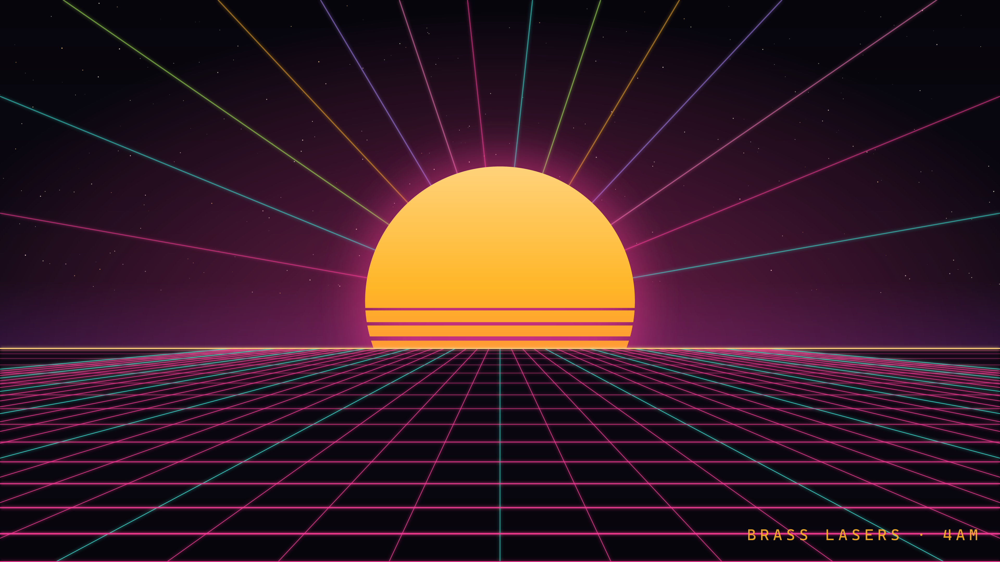

---

## The 4AM playlist

🎺 **Coming soon.** The official Brass Lasers soundtrack is being assembled: brass stabs, glitch-hop, laser fog, one-more-song energy.

<!-- PLAYLIST: replace this line with the Spotify / Apple Music / SoundCloud link -->

---

## Palette map: 4AM (the useful part)

| Role | 4AM hex | What it does |
|------|-----|--------------|
| Void canvas | `#0e0a17` | Editor / deep background |
| Lot chrome | `#0a0711` | Sidebar, activity bar, terminal chrome |
| Brass gold | `#ffb627` | Types, accents, active line numbers, find matches |
| Hot pink laser | `#ff3d9a` | Keywords, focus rings, cursor, send-button energy |
| Laser lime | `#b6ff5c` | Terminal text, git added, "this is good" green |
| Afterglow lime | `#a6e85f` | Strings: a notch calmer so big JSON files don't strobe |
| Cyan beam | `#3df2e0` | Functions, links, info |
| Pale gold | `#ffd27a` | Parameters (italic) |
| Peach fuzz | `#ffb98a` | Generic type parameters (italic) |
| Ultraviolet | `#b18cff` | Namespaces, attributes, decorators |
| Sunset | `#ff8a3d` | Numbers, constants, lifetimes |
| Soft cream | `#efe6d5` | UI text that doesn't fight the purple |

**Selection:** magenta-purple haze, so you can still see what you highlighted after three hours of bass music.

**Errors:** `#ff4d6d`, the friend who lost the rail and needs a water.

Every set lives in [`palette/`](palette/). 4AM is hand-written in full; the other sets are short specs (a canvas, an ink, and one color per syntax role) that `scripts/expand.js` grows into the full ~70-color palette in OKLCH, keeping 4AM's proportions between surfaces, borders, selections and dim text.

---

## How it's built

```
palette/*.json  ──►  scripts/expand.js  ──►  templates/**  ──►  themes/, zed/, t3/, icons/, colors/, ports/
 (specs + 4AM)      (OKLCH + contrast      (one per app)        (generated: never edit by hand)
                     repair)
```

- `npm run build` renders every palette through every template.
- `npm run check` fails if any generated file is stale, or if any palette drops below its contrast floor (52 WCAG pairs × 7 sets; Strobe holds syntax to AAA).
- `npm run art` redraws swatches, wallpapers and the social card from the palettes.
- Tag a release (`git tag v0.3.0 && git push origin v0.3.0`) and CI publishes to Open VSX, the VS Marketplace and GitHub Releases.

Want a tweak? Change a hex in `palette/`, run `npm run build`, and every app updates together.

---

## Contributing

PRs welcome if you find a token that still looks sober. Keep the chaos; keep the contrast.

- **A color looks wrong?** Open an issue with the *Developer: Inspect Editor Tokens and Scopes* output. The issue template walks you through it.
- **Want another app?** Add a template under `templates/ports/` and a line in `templates/ports/ports.json`, or open a port request.

---

## Influence

Late-night funky EDM: brass stabs, laser fog, and that "one more song" optimism. Griz / Pretty Lights / Big G energy as *palette inspiration*, not samples, logos, or official merch. Your mileage (and hydration) may vary.

- Extension ID: `heyoub.brass-lasers-4am`
- GitHub: [heyoub/brass-lasers](https://github.com/heyoub/brass-lasers)
- License: [MIT](LICENSE)

Stay weird. Ship code. Respect the lasers.
