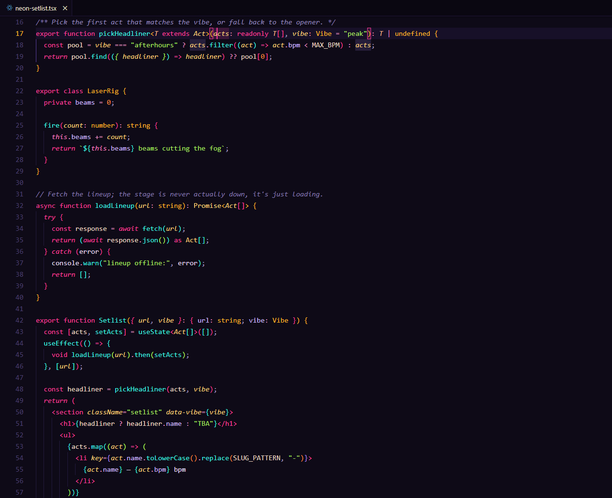
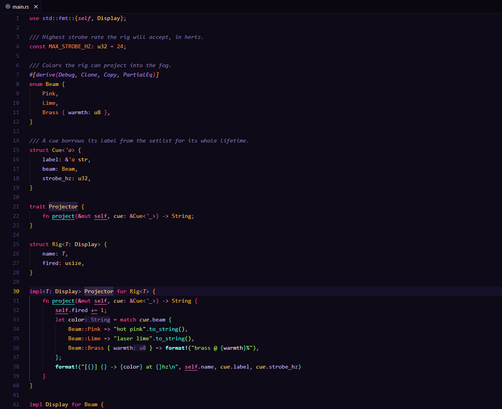
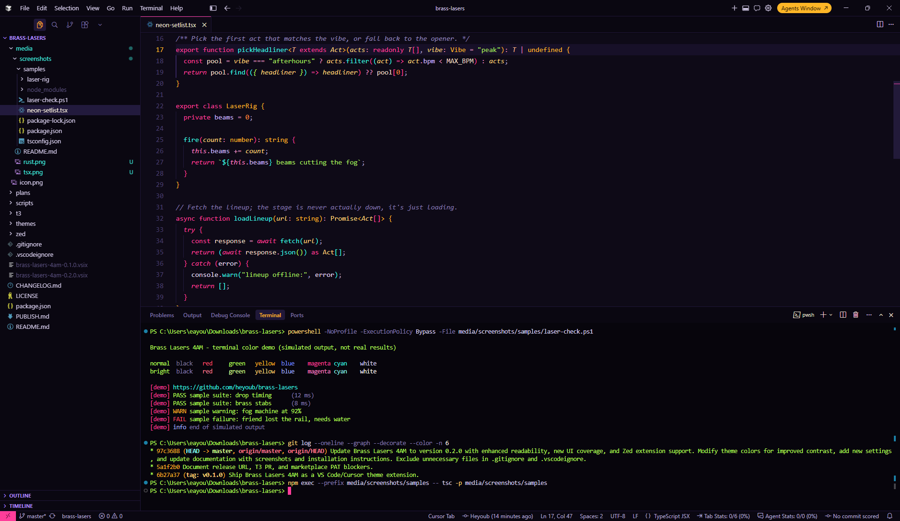
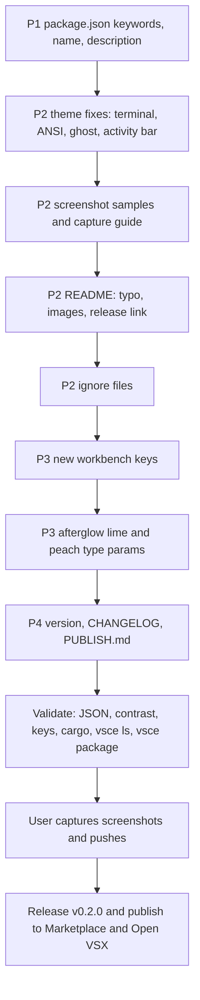

# Brass Lasers 4AM: v0.2.0 "the afterglow set", publish-readiness plan

> **STATUS: APPROVED 2026-11-14** with two corrections (folded in below):
> 1. `high contrast` dropped from keywords, leaving 27. No README high-contrast disclaimer needed.
> 2. Screenshots must be authentic. The TSX sample type-checks for real (no `typescript.validate.enable: false`), and the PowerShell demo labels its output as simulated.
>
> Other decisions:
> - Lime A `#a6e85f`, type params `#ffb98a` italic, extended displayName.
> - ansiBlack `#5f5485`, ansiBrightBlack `#857ab0`, ghost text `#7d71a3`.
> - Theme selector label stays **`Brass Lasers 4AM`**.
> - v0.1.0 release + attached VSIX **verified by user**.
>
> Scope is locked: no additions beyond this plan.
>
> **Publishing gate:** Code mode stops after `vsce package` passes. Steps that need the user, or can't be undone:
> - Screenshot capture needs a human at the GUI.
> - `VSCE_PAT` / `OVSX_PAT` are not on this machine (PUBLISH.md line 10).
> - The public registry publish happens only after the user confirms.
>
> Code mode hands those back with exact commands.

I re-read every file on 2026-11-14. All line numbers and hex values below are the **current** ones from that read.

Files read: [`package.json`](../package.json), [`README.md`](../README.md), [`CHANGELOG.md`](../CHANGELOG.md), [`.vscodeignore`](../.vscodeignore), [`.gitignore`](../.gitignore), [`PUBLISH.md`](../PUBLISH.md), [`themes/Brass-Lasers-4AM-color-theme.json`](../themes/Brass-Lasers-4AM-color-theme.json), [`t3/brass-lasers-4am.json`](../t3/brass-lasers-4am.json), [`scripts/make-icon.py`](../scripts/make-icon.py), `media/icon.png`.

Git: branch `master`, tracking `origin/master`, clean. README raw image URLs therefore use `master`.

Contrast numbers use the WCAG 2.x relative-luminance formula, computed by hand. Code mode re-verifies them with a script (Step 13).

Reference luminances:

| Surface | Hex | L |
|---|---|---|
| Terminal bg | `#07050c` | 0.00180 |
| Activity bar / sidebar bg | `#0a0711` | 0.00257 |
| Editor bg | `#0e0a17` | 0.00372 |

---

## Priority 1: Marketplace keywords, displayName, description

### Keywords (27 of the 30 allowed, after the user dropped `high contrast`)

I keep three slots free because vsce may add derived tags for theme contributions. Step 12 checks the final `<Tags>` in `extension.vsixmanifest`.

**Playful set (12): personality, festival and wook culture**

| Keyword | Why it fits |
|---|---|
| `wook` | Kept on purpose. The theme's identity, and it's in CHANGELOG line 25 |
| `edm` | Core genre |
| `rave` | Highest-traffic festival term |
| `festival` | Scene word, also used by people browsing aesthetic themes |
| `plur` | Peace Love Unity Respect: rave-culture password |
| `funk` | Griz / Big G funk lineage |
| `bass` | Bass music, the README's three hours of bass music |
| `glitch` | Glitch-hop genre, and also a cyberpunk aesthetic search term |
| `laser` | Brand noun (singular only, no `lasers` near-dup) |
| `brass` | Brand noun |
| `afterhours` | The 4AM premise |
| `lightshow` | Laser-fog visuals |

Dropped: `synth` (near-dup of `synthwave`), `4am` (already searchable through `displayName` and `name`).

**Serious set (15): high-traffic terms**

| Keyword | Why it earns the spot |
|---|---|
| `dark` | The most-filtered theme attribute on the Marketplace |
| `dark theme` | **The one deliberate near-dup.** Tags are exact-match chips, and `dark theme` is a separate popular tag page from `dark` |
| `theme` | Base category term. Kept explicit in case vsce doesn't derive it |
| `color-theme` | Conventional tag used by most theme extensions |
| `neon` | Exact aesthetic. One of the top modifiers in theme searches |
| `purple` | Dominant chrome color. Color-named searches are common |
| `pink` | Signature accent: cursor, keywords, focus |
| `gold` | Brass accent. Gold themes are a less crowded niche |
| `lime` | Strings and terminal. Requested |
| `cyan` | Functions and links. Rounds out the color searches |
| `synthwave` | Huge traffic thanks to SynthWave '84. Same neon-on-purple family |
| `retro` | Synthwave-adjacent, broad appeal |
| `vibrant` | Common query for people who want saturated themes |
| `cyberpunk` | Pink, cyan and purple neon is the cyberpunk palette |
| ~~`high contrast`~~ | **Dropped by user.** Searchers may expect an accessibility theme, and high syntax contrast doesn't make the whole UI accessibility-compliant |
| `cursor` | Primary target editor. Users search with editor qualifiers |

Final array:

```json
"keywords": [
  "wook", "edm", "rave", "festival", "plur", "funk", "bass", "glitch",
  "laser", "brass", "afterhours", "lightshow",
  "dark", "dark theme", "theme", "color-theme", "neon", "purple", "pink",
  "gold", "lime", "cyan", "synthwave", "retro", "vibrant", "cyberpunk",
  "cursor"
]
```

### displayName (package.json line 3)

- Current: `Brass Lasers 4AM`
- **Proposed: `Brass Lasers 4AM — Neon Synthwave Dark Theme`**
- Brand first, then three top search words.
- The theme **label** (`contributes.themes[0].label`, line 43) stays `Brass Lasers 4AM`. Existing `workbench.colorTheme` settings and README line 55 keep working.
- The extension ID is unchanged.

### description (package.json line 4)

Proposed:

> Neon synthwave dark theme for VS Code & Cursor — void-purple chrome, brass-gold accents, hot-pink lasers, lime strings. Vibrant, cyberpunk-retro EDM energy that's still readable at 4AM.

`high-contrast` was also removed from the description, for the same reason it was dropped from the keywords.

The searchable words land in the first 100 characters, which is where Marketplace cards truncate. The voice stays.

---

## Priority 2: Must-fix before publishing

### 2a. Terminal foreground: make VS Code match the lime promise

**Recommendation: change the VS Code theme, not T3.** Three places already promise lime, and only one file is wrong:

- README line 98: "Terminal (lime on near-black)"
- PUBLISH.md line 21: "lime terminal text"
- T3 `terminalForeground` (t3 line 61): `#b6ff5c`

A lime terminal is also the most recognizable thing in the full-window screenshot.

| Key (theme line) | Before | After | Contrast on `#07050c` |
|---|---|---|---|
| `terminal.foreground` (259) | `#e6dcf5` | **`#b6ff5c`** | 16.84:1 |

**Trade-off:** `terminal.ansiGreen` (265) is also `#b6ff5c`, so green ANSI output looks the same as plain text. That's normal for green-phosphor terminals. Success marks still stand out because they're usually bold or bright green (`#d0ff94`). I'm leaving it as is and flagging it here.

### 2b. ANSI palette audit on `#07050c`

| Key (line) | Hex | Contrast | Verdict |
|---|---|---|---|
| `ansiBlack` (263) | `#1c1433` | **1.16:1** | Invisible. Fix |
| `ansiRed` (264) | `#ff4d6d` | 6.31:1 | OK |
| `ansiGreen` (265) | `#b6ff5c` | 16.84:1 | OK |
| `ansiYellow` (266) | `#ffb627` | 11.56:1 | OK |
| `ansiBlue` (267) | `#7c8cff` | 6.81:1 | OK |
| `ansiMagenta` (268) | `#ff3d9a` | 6.16:1 | OK |
| `ansiCyan` (269) | `#3df2e0` | 14.45:1 | OK |
| `ansiWhite` (270) | `#d9cfee` | 13.62:1 | OK |
| `ansiBrightBlack` (271) | `#6f6494` | **3.79:1** | Borderline. Used for dim output: zsh/pwsh autosuggest, git dim, test timings |
| Bright Red / Green / Yellow / Blue / Magenta / Cyan / White (272–278) | lighter tints of the above | all higher than their base | OK |

**The requested `#3a2f5c` only reaches 1.68:1.** That's better, but still basically invisible. Options:

| Candidate ansiBlack | Source | Contrast |
|---|---|---|
| `#3a2f5c` | your suggestion | 1.68:1 |
| `#4b3f70` | palette: line-number color | 2.17:1 |
| **`#5f5485`** | palette: the color ghost text and the activity bar are moving off | **2.99:1** |

**Recommended:**

| Key | Before | After | Contrast |
|---|---|---|---|
| `terminal.ansiBlack` (263) | `#1c1433` | **`#5f5485`** | 2.99:1 (readable but still "dark") |
| `terminal.ansiBrightBlack` (271) | `#6f6494` | **`#857ab0`** | 5.22:1 (same as comment color, so dim output matches editor comments) |

- **Black used as a background:** `ansiWhite` text on the new `ansiBlack` is 4.56:1, so ANSI background blocks stay legible.
- **Black stays darker than bright black** (2.99 vs 5.22), so the two remain distinguishable.
- VS Code's `terminal.minimumContrastRatio` (default 4.5) also lifts foreground text at render time. That's a safety net, though. The theme shouldn't rely on it, and it doesn't touch ANSI backgrounds.

### 2c. Ghost text and inactive activity bar icons

Ghost text renders on the **editor** background (`#0e0a17`), not the terminal background, so I give both numbers.

| Candidate | vs `#07050c` | vs `#0e0a17` (editor) | vs `#0a0711` (activity bar) |
|---|---|---|---|
| `#5f5485` (current) | 2.99:1 | 2.88:1 | 2.94:1 |
| `#7a6fa3` (suggested) | 4.47:1 | 4.31:1 | 4.40:1 |
| **`#7d71a3`** (recommended, existing palette: tab/breadcrumb inactive, T3 `iconMuted`) | **4.60:1** | **4.43:1** | **4.53:1** |

Why `#7d71a3`:

- It reuses an existing palette color instead of adding a new one.
- It has slightly higher contrast than `#7a6fa3`.
- It's still clearly dimmer than comments (`#857ab0`, 5.03:1, italic). Ghost suggestions stay non-italic and lower contrast, so they don't read as real comments.
- Being just under 4.5 on the editor background is intentional: ghost text has to look provisional.

| Key (line) | Before | After |
|---|---|---|
| `editorGhostText.foreground` (51) | `#5f5485` | **`#7d71a3`** |
| `activityBar.inactiveForeground` (101) | `#5f5485` | **`#7d71a3`** (4.53:1, well above the 3:1 WCAG minimum for icons) |

`gitDecoration.ignoredResourceForeground` (131) also uses `#5f5485` (2.94:1). **Leave it.** Ignored files are supposed to fade into the background.

### 2d. README typo

- README line 107: `milage` → `mileage`.

### 2e. Screenshots setup

New files (all excluded from the VSIX):

```
media/screenshots/
  README.md                      <- exact capture instructions (below)
  samples/
    package.json                 <- private, devDeps: typescript, react, @types/react (pinned)
    tsconfig.json                <- strict, jsx: react-jsx, noEmit
    neon-setlist.tsx             <- TS/React showcase; must pass `npx tsc -p .` with 0 errors
    laser-rig/
      Cargo.toml                 <- zero-dependency crate so rust-analyzer gives semantic tokens
      src/main.rs                <- Rust showcase
    laser-check.ps1              <- colored terminal output for shot 3
```

**neon-setlist.tsx must show:**

- `import`/`export`, `interface` + `type` alias
- A generic `function pickHeadliner<T extends Act>(acts: T[], vibe: Vibe): T`
- Default + destructured parameters
- A `const enum` or union of string literals
- A template literal with `${}` interpolation
- A regex
- A number, a boolean
- A JSDoc block + a line comment
- `async`/`await` + `try`/`catch`
- A React component that uses JSX tags, a custom component, props, `className`, `{expr}` children, `.map()` + `key`
- `this` inside a class method

Realistic and festival-flavored, about 60 lines so it fits one screen.

**laser-rig/src/main.rs must show:**

- `use`, `mod`, a `struct` with lifetimes `'a`, `enum` with variants
- A `trait` + `impl<T: Display>`
- Generic `fn`, `&mut self` (mutable underline), `match`, `if let`
- `#[derive(...)]` attribute, `macro_rules!` + `println!`/`format!`
- A const, a numeric literal with suffix, an escape `\n`
- An `unsafe` block, doc comments `///`
- `Self`/`self`

It must compile with **zero warnings** (no unused items), so there are no yellow squiggles in the shot.

**TSX authenticity:**

- `npm install` runs inside `media/screenshots/samples`.
- `node_modules` is already gitignored at any depth (`.gitignore` line 1), and `media/screenshots/**` is excluded from the VSIX.
- `npx tsc -p media/screenshots/samples` must report 0 errors before capture. No validation suppression.

**laser-check.ps1** (Windows PowerShell 5.1 compatible, uses `[char]27`) prints:

1. A banner in plain foreground (lime): `Brass Lasers 4AM — terminal color demo (simulated output, not real results)`
2. A 16-color ANSI swatch row (normal + bright, labeled)
3. A clearly labeled `[demo]` block of sample build/test lines: green pass, yellow warning, red error, dim (bright-black) timings, cyan URL, magenta tag. Every line is prefixed `[demo]`.
4. Then the instructions say to run the **real** `git log --oneline --graph --decorate --color -n 8` and `npx tsc -p media/screenshots/samples` (real, passing output)

**Capture instructions (written into media/screenshots/README.md):**

Setup:

1. Install the freshly packaged VSIX (Step 12), then `Ctrl+K Ctrl+T` → **Brass Lasers 4AM**.
2. Temporary user settings for capture:

   ```json
   "editor.fontSize": 15,
   "editor.lineHeight": 1.6,
   "editor.minimap.enabled": false,
   "editor.stickyScroll.enabled": false,
   "workbench.statusBar.visible": true,
   "window.zoomLevel": 0
   ```

   No validation suppression: the sample genuinely type-checks after `npm install` in `samples/`.
3. Maximize the window on a 1920×1080 (or larger) display. Close the Welcome tab, notifications and Copilot/Cursor popups.

Shot 1: `tsx.png`

1. Open the repo root.
2. Open `media/screenshots/samples/neon-setlist.tsx`.
3. Click inside the generic function so word highlights and bracket pairs show.
4. `Ctrl+B` to hide the sidebar.
5. `Win+Shift+S` → **Window** mode → click the VS Code window.
6. Paste into Paint → crop to the editor area plus tabs → save as `media/screenshots/tsx.png`.

Shot 2: `rust.png`

1. **File → Open Folder** → `media/screenshots/samples/laser-rig`. rust-analyzer needs the `Cargo.toml` at the workspace root.
2. Wait for "rust-analyzer: ready" in the status bar so semantic tokens apply (`&mut` underline, lifetimes).
3. Open `src/main.rs` and put the cursor on a line in the trait impl.
4. Capture the same way → `media/screenshots/rust.png`.

Shot 3: `full-window.png`

1. Reopen the repo root.
2. Sidebar visible (Explorer, with a modified file for git decoration colors).
3. Open `neon-setlist.tsx`.
4. `` Ctrl+` `` to open the terminal at about 40% height.
5. Run `powershell -ExecutionPolicy Bypass -File media/screenshots/samples/laser-check.ps1`, then `git log --oneline --graph --decorate --color -n 8`.
6. Capture the **whole window** without cropping → `media/screenshots/full-window.png`.

Post-processing:

- PNG only (the Marketplace rejects SVG).
- Keep each file under about 1 MB. Optionally run `npx oxipng -o 4 media/screenshots/*.png` or use TinyPNG.
- Commit and **push before `vsce publish`**, otherwise the Marketplace page shows broken images.
- Revert the temporary settings.

**README embed.** Insert after line 7, the disclaimer:

```markdown



```

### 2f. Release, .gitignore and .vscodeignore

Verified already:

- `.gitignore` line 2 has `*.vsix` ✅
- `.vscodeignore` line 7 excludes `t3/**` ✅
- `.vscodeignore` line 13 excludes `scripts/**` ✅
- `.vscodeignore` line 9 excludes `PUBLISH.md` ✅

**v0.1.0 release + VSIX asset: verified by the user via GitHub.** Code mode still runs the local VSIX-in-git checks below (skip `gh release view` / curl):

```bash
gh release view v0.1.0 --repo heyoub/brass-lasers
# fallback without gh:
curl -s -o NUL -w "%{http_code}" https://github.com/heyoub/brass-lasers/releases/tag/v0.1.0
git ls-files "*.vsix"                   # must print nothing
git log --all --oneline -- "*.vsix"     # must print nothing; if not, VSIX was committed historically
```

If v0.1.0 is missing:

```bash
git tag v0.1.0 <commit-sha-of-0.1.0>
git push origin v0.1.0
gh release create v0.1.0 brass-lasers-4am-0.1.0.vsix --repo heyoub/brass-lasers --title "v0.1.0 — first light on the lot" --notes "Debut set. See CHANGELOG.md."
```

For this release (after Step 12):

```bash
git add -A
git commit -m "v0.2.0 — the afterglow set"
git tag v0.2.0
git push origin master --tags
gh release create v0.2.0 brass-lasers-4am-0.2.0.vsix --repo heyoub/brass-lasers --title "v0.2.0 — the afterglow set" --notes-file RELEASE_NOTES.md
```

`RELEASE_NOTES.md` is a temp file holding the 0.2.0 CHANGELOG section. Delete it afterwards and add it to `.vscodeignore`.

**.vscodeignore additions:**

```
media/screenshots/**
plans/**
.github/**
**/target/**
RELEASE_NOTES.md
```

**.gitignore addition:** `target/` (the Cargo build output from the Rust sample).

Publishing commands (run only after the user confirms and tokens are present):

```bash
npx @vscode/vsce publish --packagePath brass-lasers-4am-0.2.0.vsix -p $env:VSCE_PAT
npx ovsx publish brass-lasers-4am-0.2.0.vsix -p $env:OVSX_PAT
```

**README release link** (lines 33 and 41): change the hardcoded `v0.1.0` and `brass-lasers-4am-0.1.0.vsix` to `https://github.com/heyoub/brass-lasers/releases/latest` and `brass-lasers-4am-<version>.vsix`, so it never drifts again. PUBLISH.md's `0.1.0` references (lines 3, 4, 19, 28, 46, 74, 110, 111) → `0.2.0`.

---

## Priority 3: Nice-to-haves

### 3a. New workbench keys, all from the existing palette

Insert after line 72 (overview ruler group) and in new grouped blocks. **Every key is checked against https://code.visualstudio.com/api/references/theme-color in Step 13. Any key not listed there gets dropped.**

Overview ruler:

| Key | Value |
|---|---|
| `editorOverviewRuler.addedForeground` | `#b6ff5c` |
| `editorOverviewRuler.modifiedForeground` | `#ffb627` |
| `editorOverviewRuler.deletedForeground` | `#ff4d6d` |

Sticky scroll:

| Key | Value |
|---|---|
| `editorStickyScroll.background` | `#120d1e` |
| `editorStickyScroll.border` | `#2a1f47` |
| `editorStickyScroll.shadow` | `#00000080` |
| `editorStickyScrollHover.background` | `#1c1433` |

Settings editor:

| Key | Value |
|---|---|
| `settings.headerForeground` | `#ffb627` |
| `settings.settingsHeaderHoverForeground` | `#ffd27a` |
| `settings.modifiedItemIndicator` | `#ff3d9a` |
| `settings.headerBorder` | `#1f1638` |
| `settings.sashBorder` | `#1f1638` |
| `settings.focusedRowBackground` | `#1c1433` |
| `settings.focusedRowBorder` | `#ff3d9a` |
| `settings.rowHoverBackground` | `#140f21` |
| `settings.dropdownBackground` | `#1b142e` |
| `settings.dropdownForeground` | `#efe6d5` |
| `settings.dropdownBorder` | `#2a1f47` |
| `settings.dropdownListBorder` | `#2a1f47` |
| `settings.checkboxBackground` | `#1b142e` |
| `settings.checkboxForeground` | `#ffb627` |
| `settings.checkboxBorder` | `#4b3a80` |
| `settings.textInputBackground` | `#140f21` |
| `settings.textInputForeground` | `#efe6d5` |
| `settings.textInputBorder` | `#2a1f47` |
| `settings.numberInputBackground` | `#140f21` |
| `settings.numberInputForeground` | `#efe6d5` |
| `settings.numberInputBorder` | `#2a1f47` |

Chat panel:

| Key | Value |
|---|---|
| `chat.requestBackground` | `#1b142e` |
| `chat.requestBorder` | `#2a1f47` |
| `chat.slashCommandBackground` | `#ff3d9a33` |
| `chat.slashCommandForeground` | `#ff7fc0` |
| `chat.avatarBackground` | `#1f1638` |
| `chat.avatarForeground` | `#ffb627` |
| `chat.editedFileForeground` | `#ffb627` |
| `chat.linesAddedForeground` | `#b6ff5c` |
| `chat.linesRemovedForeground` | `#ff4d6d` |

Inline chat:

| Key | Value |
|---|---|
| `inlineChat.background` | `#1b142e` |
| `inlineChat.foreground` | `#efe6d5` |
| `inlineChat.border` | `#ff3d9a` |
| `inlineChat.shadow` | `#00000080` |
| `inlineChatInput.background` | `#140f21` |
| `inlineChatInput.border` | `#2a1f47` |
| `inlineChatInput.focusBorder` | `#ff3d9a` |
| `inlineChatInput.placeholderForeground` | `#7d71a3` |
| `inlineChatDiff.inserted` | `#b6ff5c1f` |
| `inlineChatDiff.removed` | `#ff4d6d26` |

Notes:

- `chat.linesAdded/RemovedForeground` and `chat.editedFileForeground` are newer than the `^1.85.0` engine. Older VS Code builds ignore unknown keys harmlessly, so there's no engine bump.
- **Cursor caveat:** Cursor's Composer/Agent panel is custom UI. It mostly reads generic keys that are already themed (`input.*`, `editorWidget.*`, `button.*`, `list.*`, `badge.*`), not `chat.*`. The `chat.*` keys fully apply in VS Code Copilot Chat.

### 3b. Toned-down lime for strings (your taste call)

| Option | Hex | Contrast on editor | Note |
|---|---|---|---|
| Before | `#b6ff5c` | 16.24:1 | Max saturation, max lightness |
| **A: "afterglow lime" (recommended)** | **`#a6e85f`** | 13.34:1 | Same acid hue, about 10% calmer. Still unmistakably lime |
| B: "sunrise lime" | `#9fd96a` | 11.73:1 | Softer and more pastel. Loses some laser |

Apply option A **only to string-like syntax**:

| Location | Line |
|---|---|
| tokenColors "Strings" | 321 |
| tokenColors "Markdown code" | 431 |
| semanticTokenColors `string` | 496 |
| `symbolIcon.stringForeground` | 288 |

**Keep `#b6ff5c`** for signals and branding: `terminal.foreground`, `ansiGreen`, gutter/overview/git added, diff inserted, bracket pair 4, `editor.focusedStackFrameHighlightBackground`.

README palette table: add an "Afterglow lime `#a6e85f`: strings" row. Rework the Laser lime row (line 69) to "Terminal text, git added, 'this is good' green".

### 3c. Distinct type-parameter color

- Current: `typeParameter` (line 476) = `#ffd27a` italic, which is the same as `parameter` (line 483).
- **Proposed: `#ffb98a` italic, "peach fuzz".** It's already in the project palette (T3 `warningForeground`, t3 line 38).
- Contrast 11.69:1 on the editor background.
- It sits between brass types (`#ffb627`) and sunset constants (`#ff8a3d`), so it still reads as type-family but is clearly different from pale-gold params.

Changes:

- `semanticTokenColors.typeParameter` (476) → `{ "foreground": "#ffb98a", "fontStyle": "italic" }`
- New tokenColors rule, inserted right after "Types and classes" (ends line 342), for non-LSP grammars:

  ```json
  { "name": "Generic type parameters: peach fuzz",
    "scope": ["entity.name.type.parameter", "meta.type.parameters entity.name.type", "storage.type.generic"],
    "settings": { "foreground": "#ffb98a", "fontStyle": "italic" } }
  ```

---

## Priority 4: Version, changelog, T3 sync, validation

### Version

`0.1.0` → **`0.2.0`** (package.json line 5). This is a minor bump: visible color changes plus new coverage, no breaking renames, still pre-1.0.

### CHANGELOG

New section above line 5: `## 0.2.0 — the afterglow set`. It covers:

- Terminal: lime foreground, `ansiBlack` and `ansiBrightBlack` with contrast numbers
- Ghost text and inactive activity bar contrast fix, with numbers
- Afterglow lime strings
- Peach type parameters
- Sticky scroll, overview ruler git marks, settings editor, chat and inline chat coverage
- Marketplace: keywords, displayName, description
- README: screenshots, `releases/latest` link, typo, palette table
- Screenshot samples: real type-checking TSX and Rust, and a terminal demo labeled as simulated
- Packaging: `.vscodeignore` and `.gitignore` additions
- Screenshot samples and capture guide

### T3 sync (checked key by key)

T3 has no syntax, ANSI, ghost-text, chat or settings keys. Its `terminalForeground` is already `#b6ff5c`. **No T3 color changes are needed.**

Don't change T3's `"version": 1`. That's the T3 schema version, not the theme version. The changelog notes that T3 was checked and is unchanged.

### Validation

1. `node -e "for (const f of ['package.json','themes/Brass-Lasers-4AM-color-theme.json','t3/brass-lasers-4am.json']) JSON.parse(require('fs').readFileSync(f,'utf8')), console.log('ok', f)"`
2. Contrast script: a node one-liner recomputes every ratio in this plan. They should all match to ±0.02.
3. Check every new workbench key against the official theme-color reference. Drop anything not listed.
4. `cargo check` in `media/screenshots/samples/laser-rig` if cargo is installed. Must show 0 warnings. Also `npx tsc -p media/screenshots/samples`, which must show 0 errors.
5. `npx @vscode/vsce ls`: the file list must contain only `package.json`, `README.md`, `CHANGELOG.md`, `LICENSE`, `media/icon.png`, `themes/…json`.
6. `npx @vscode/vsce package`: must finish with **no warnings**. Then unzip `extension.vsixmanifest` and confirm the `<Tags>` count is ≤ 30 and `<DisplayName>` is correct.

---

## Execution flow


